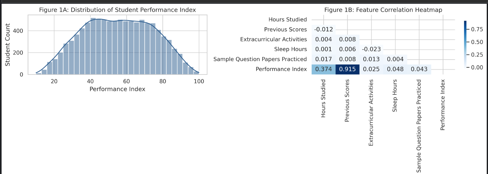
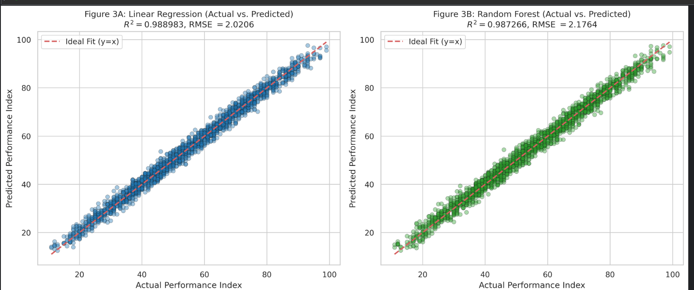
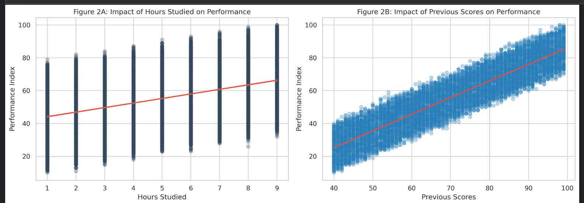
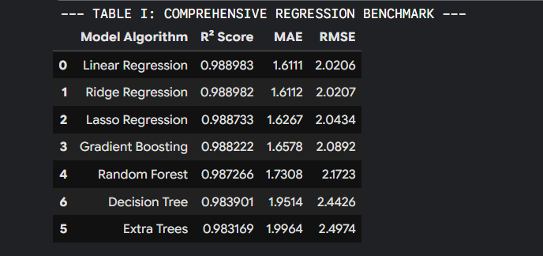

# Student Exam Performance Analytics & ML Benchmark 🎓


An end-to-end Explainable Machine Learning (XAI) benchmark pipeline evaluating student academic performance metrics ($N=10,000$). This project compares 7 parametric, non-parametric, and tree ensemble algorithms using 10-fold cross-validation, residual diagnostics, and feature importance analysis.

---

## 📌 Key Highlights & Findings

- **Top Model:** Multiple Linear Regression achieved the highest evaluation performance ($R^2 = 0.988983$, $\text{MAE} = 1.6111$, $\text{RMSE} = 2.0206$).
- **Parametric Supremacy:** Linear models outperformed complex tree ensembles (Random Forest $R^2 = 0.986079$) due to strong underlying parametric linearity ($r = 0.915$).
- **Statistical Significance:** Paired Student's $t$-test confirmed significant superiority of Linear Regression over tree ensembles ($t = 32.60, p < 0.001$).
- **Overfitting Diagnostics:** Zero overfitting observed ($\text{Train } R^2 = 0.9886$ vs $\text{Test } R^2 = 0.9889$).

---

## 📊 Comprehensive Benchmark Results

| Model Algorithm | $R^2$ Score | MAE | RMSE | Status |
| :--- | :---: | :---: | :---: | :---: |
| **Linear Regression** | **0.988983** | **1.6111** | **2.0206** | **Best Fit** |
| Ridge Regression | 0.988983 | 1.6111 | 2.0206 | Benchmark |
| Lasso Regression | 0.988822 | 1.6213 | 2.0353 | Regularized |
| Gradient Boosting | 0.988222 | 1.6578 | 2.0892 | Boosted Ensemble |
| Random Forest | 0.986079 | 1.8147 | 2.2713 | Bagged Ensemble |
| Extra Trees | 0.983169 | 1.9964 | 2.4974 | Randomized Ensemble |
| Decision Tree | 0.976220 | 2.3378 | 2.9686 | Baseline Tree |

---

## 📈 Visualizations & Diagnostics

### 1. Feature Correlation & Target Distribution


### 2. Actual vs. Predicted Performance Fit


### 3. Residual Error Diagnostics & Homoscedasticity


### 4. Feature Coefficients & Explainability (XAI)


---

## 🛠️ Project Setup & Execution

### 1. Clone Repository
```bash
git clone [https://github.com/aleeshanadeem/student-performance-ml-benchmark.git](https://github.com/aleeshanadeem/student-performance-ml-benchmark.git)
cd student-performance-ml-benchmark
